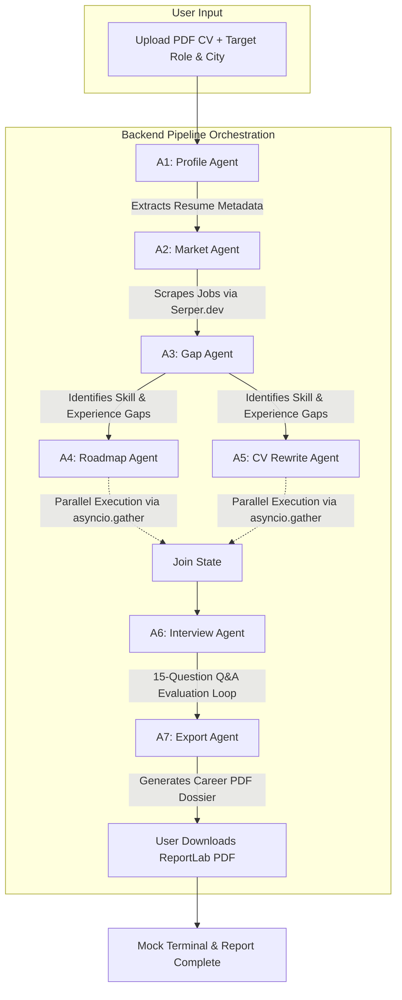

# Ustaad (اُستاد) — AI Career OS for Pakistani Tech Talent

[](https://www.kaggle.com/competitions/vibecoding-agents-capstone-project)
[](https://aistudio.google.com/)
[](https://opensource.org/licenses/MIT)

> **Ustaad** (Urdu: *Teacher / Master*) is an AI-powered Career Operating System designed specifically to help Pakistani computer science and IT graduates navigate, prepare for, and succeed in the local technology job market. 

---

## 🎯 The Problem & Our Mission

Every year, tens of thousands of CS and IT graduates enter the Pakistani tech sector. However, a major disconnect exists between university curricula and local industry demands. Graduates frequently struggle with:
1. **Curriculum Gaps**: Lack of awareness regarding which modern technical skills are actively sought after by employers in cities like Lahore, Karachi, and Islamabad.
2. **ATS Incompatibility**: Resumes that fail automated Applicant Tracking Systems (ATS) screening.
3. **Behavioral & Technical Readiness**: Little to no structured mock interview practice.

**Ustaad** solves this by serving as an intelligent, automated personal career concierge. By uploading a single PDF CV and specifying their target role and city, candidates receive a data-grounded readiness audit, a customized learning roadmap, an ATS-optimized CV rewrite, interactive mock interviews, and a downloadable PDF career dossier.

---

## 🏗️ Multi-Agent Architecture & Pipeline Flow

Ustaad's backend coordinates a highly modular **7-Agent Pipeline** utilizing sequential dependencies and concurrent execution pathways to ensure speed, structured data modeling, and grounding.



### 🤖 The 7 Specialized Agents

| Agent | Name | Responsibility / Prompt Focus | LLM Model (Default) | Inputs / Context |
|---|---|---|---|---|
| **A1** | **Profile Agent** | Parses raw, unstructured CV text into a rigid JSON resume profile (education, experience, technical skills, projects). | `gemini-2.5-flash` | Raw extracted CV text |
| **A2** | **Market Agent** | Conducts search queries targeting local job boards in Pakistan (Rozee.pk, Mustakbil, LinkedIn) via Serper.dev and parses requirements. | `gemini-2.5-flash` | Target Role, Target City, Live Serper Search Results |
| **A3** | **Gap Agent** | Performs a comparative analysis of the candidate's parsed profile against scraped real-time market demands to calculate a readiness score. | `gemini-2.5-flash` | A1 JSON Profile + A2 Market Data |
| **A4** | **Roadmap Agent** | Builds a highly actionable 30/60/90-day learning curriculum tailored to bridge the identified gaps, linking to free learning resources. | `gemini-2.5-flash` | A3 Gap Analysis Report |
| **A5** | **CV Rewrite Agent** | Rewrites CV descriptions, summaries, and skill blocks to optimize for ATS scanners using local keyword mappings. | `gemini-2.5-flash` | A1 Profile + A2 Market + A3 Gap Data |
| **A6** | **Interview Agent** | Compiles a custom bank of technical, behavioral, and HR questions based on the gaps/profile, then evaluates answers on a 1-10 scale. | `gemini-2.5-flash` | A1 Profile + A2 Market + User's Input answers |
| **A7** | **Export Agent** | Aggregates pipeline analytics and mock interview session transcripts to produce a styled PDF Dossier. | ReportLab SDK | Complete Session Database Row |

---

## 🎓 Kaggle & Google Course Concepts Demonstrated

This project is built directly to showcase core agentic paradigms taught in the **Google AI Agents Intensive Course**:

1. **Multi-Agent Collaboration & Orchestration**:
   The orchestrator coordinates seven distinct agents, maintaining session state via a Supabase database. It schedules Agents 4 and 5 in parallel via `asyncio.gather()`, speeding up processing times by ~40%.
2. **Tool Use & Real-Time Grounding**:
   The **Market Agent** utilizes the Serper.dev API to run four targeted local Google Search queries per session (e.g. `"Python Developer jobs Karachi mustakbil site:mustakbil.com"`). This grounds the AI pipeline in live reality, avoiding static model training limits.
3. **Structured Outputs & Schema Hardening**:
   Every agent is bound to a strict output schema using Gemini's `response_mime_type="application/json"` configuration. Responses are processed using a multi-layered fallback parser to prevent parsing crashes.
4. **Production-Focused Async Execution**:
   Real-time progress is streamed live to the Next.js frontend using Server-Sent Events (SSE), allowing the user to watch the pipeline execute progressively without page reloads.

---

## 🛠️ Tech Stack

* **Frontend**: Next.js 14, TypeScript, Tailwind CSS, Lucide Icons, Framer Motion
* **Backend**: Python 3.10+, FastAPI, PyMuPDF (PDF text extraction), ReportLab (PDF generation)
* **AI/LLM**: Google Gemini Generative AI SDK (`google-generativeai`)
* **State / Persistence**: Supabase (PostgreSQL)
* **API Tools**: Serper.dev (Google Search API)

---

## 🚀 Setup & Installation (Local Execution)

### Database Setup
1. Create a free project at [Supabase](https://supabase.com/).
2. Open the SQL Editor and execute the schema script located at `backend/db/schemas.sql` to initialize the `sessions` and `interview_sessions` tables.

### Backend Setup (FastAPI)
1. Navigate to the backend folder:
   ```bash
   cd backend
   ```
2. Create and activate a Python virtual environment:
   ```bash
   python -m venv venv
   # On Windows:
   venv\Scripts\activate
   # On macOS/Linux:
   source venv/bin/activate
   ```
3. Install dependencies:
   ```bash
   pip install -r requirements.txt
   ```
4. Configure your environment variables:
   ```bash
   cp .env.example .env
   ```
   Open `.env` and enter your API credentials:
   - `GEMINI_API_KEY`: Obtain from [Google AI Studio](https://aistudio.google.com/).
   - `SERPER_API_KEY`: Obtain from [Serper.dev](https://serper.dev/).
   - `SUPABASE_URL` and `SUPABASE_SERVICE_KEY`: Grab from your Supabase Project Settings -> API.
5. Spin up the backend server:
   ```bash
   uvicorn main:app --reload --port 8000
   ```
   *The backend will run on `http://localhost:8000`. You can inspect the health check at `/health`.*

### Frontend Setup (Next.js)
1. Navigate to the frontend folder:
   ```bash
   cd ../frontend
   ```
2. Install Node packages:
   ```bash
   npm install
   ```
3. Configure environment variables:
   ```bash
   cp .env.example .env.local
   ```
   *Make sure `NEXT_PUBLIC_API_URL` is set to your local backend (`http://localhost:8000`).*
4. Run the development server:
   ```bash
   npm run dev
   ```
   *Open `http://localhost:3000` (or `http://localhost:3001` if port 3000 is occupied) in your browser.*

---

## 📂 Project Structure

```
├── backend/
│   ├── agents/               # AI Agents pipeline and orchestration logic
│   │   ├── prompts/          # System instruction templates & prompt schemas
│   │   ├── gemini_utils.py   # Consolidated Gemini client, backoffs, and JSON parse utilities
│   │   ├── orchestrator.py   # Pipeline manager (SSE triggers, parallel workflows)
│   │   └── ...               # Individual agent definitions
│   ├── db/                   # Database client configurations & SQL tables schema
│   ├── routers/              # FastAPI router modules (pipeline, interview, pdf export)
│   ├── tools/                # Hardened fitz CV parser, Serper scraper, and ReportLab generator
│   ├── main.py               # FastAPI server entry point (CORS, router links)
│   └── requirements.txt      # Python package declarations
├── frontend/
│   ├── app/                  # Next.js App Router (Landing, Dashboard, Mock Terminal, Dossier pages)
│   ├── components/           # UI Components (Cards, Upload dropzone, Theme toggler, Skeletons)
│   ├── lib/                  # Fetch wrappers & EventSource SSE listener
│   └── package.json          # Node dependency declarations
├── README.md                 # Project README
└── ustaad_implementation_plan.md   # Original system requirements plan
```

---

## 👥 The Team

* **Hassan** (Backend Architecture & Agent Pipeline)
* **Abdul Mannan** (Frontend Engineering & Responsive UI/UX Design)
