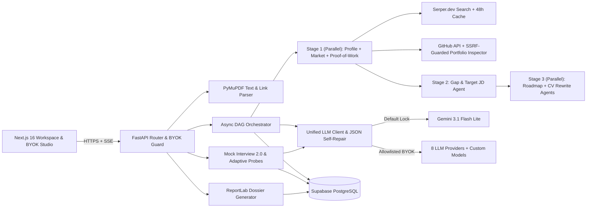

# Ustaad

**Multi-agent career intelligence, live Pakistani market grounding and configurable mock interviews for software graduates.**

[Open Ustaad](https://www.ustaad.systems)

[License: Apache 2.0](LICENSE)

[Methodology & team](https://www.ustaad.systems/about) · [BYOK & provider model](docs/PROVIDERS_AND_BYOK.md) · [Verification record](docs/VERIFICATION.md)

Ustaad turns a graduate's PDF CV and target role into a grounded career assessment tailored to Pakistan's technology job market. A parallel multi-agent pipeline extracts structured candidate data, queries live Pakistani job listings (`rozee.pk`, `mustakbil.com`, LinkedIn Pakistan and local hiring boards), evaluates skill and job-description gaps, builds a 30/60/90-day free learning roadmap and rewrites CV experience into quantified ATS-ready bullets.

The platform runs free out of the box on a server-locked `gemini-3.1-flash-lite` baseline, while an optional browser-only Bring Your Own Key (BYOK) studio lets users run analyses and mock interviews against eight allowlisted LLM providers—including custom model identifiers—without storing or logging user API keys on the server. Session state and interview transcripts persist in Supabase PostgreSQL so sessions can be resumed, printed as a single-column A4 ATS resume or exported as a ReportLab PDF Career Dossier.

## Contents

- [Origin — Kaggle × Google AI Agents Capstone](#origin--kaggle--google-ai-agents-capstone)
- [Capabilities](#capabilities)
- [Career analysis workflow](#career-analysis-workflow)
- [Architecture](#architecture)
- [Installation](#installation)
- [Configuration](#configuration)
- [API interface](#api-interface)
- [Privacy, BYOK and operational boundaries](#privacy-byok-and-operational-boundaries)
- [Verification](#verification)
- [Operations](#operations)
- [Repository structure](#repository-structure)
- [Documentation](#documentation)
- [Team](#team)
- [License](#license)

## Origin — Kaggle × Google AI Agents Capstone

Ustaad originated as a submission to the **Kaggle × Google 5-Day AI Agents Intensive Capstone** and has evolved into **Ustaad 2.1**, an open-source career operating system maintained by **AgenticEra Systems**. The architecture demonstrates six production agentic patterns in a single low-cost deployment: parallel + sequential DAG orchestration (`asyncio.gather`), live search tool grounding with a 48-hour role-and-city cache, SSRF-guarded concurrent Proof-of-Work auditing (GitHub API + personal portfolio HTML inspection), structured JSON outputs with 1-shot self-repair, multi-turn stateful interview evaluation with adaptive follow-up probes and request-scoped multi-provider BYOK routing.

**For reviewers and contributors:** start with [LLM providers and BYOK](docs/PROVIDERS_AND_BYOK.md), [recorded verification](docs/VERIFICATION.md), [Supabase setup](docs/SUPABASE_SETUP.md) and [deployment procedures](docs/DEPLOYMENT.md).

## Capabilities

| Area | Functionality |
| --- | --- |
| CV parsing and profiling | Text extraction via PyMuPDF (`fitz`) and structured JSON normalization of education, skills, projects, certifications, embedded links and detected CV weaknesses |
| Proof-of-Work Auditor | SSRF-guarded concurrent audit of public GitHub activity (90-day commits, language breakdown, demo ratios) and personal portfolio health (HTTPS, OpenGraph tags, SPA shell warning, contact CTA) |
| Pakistani market grounding | Four concurrent Serper.dev search queries per cache miss, live applyable job matches from Rozee.pk/LinkedIn, statutory PKR FBR net-take-home tax calculations and 48-hour role+city cache |
| Gap and Target JD analysis | Quantified `0–100` Readiness Score, prioritized critical vs. nice-to-have gaps, plus optional `jd_match_score` and missing-keyword extraction against a pasted job description |
| Interactive 30/60/90 roadmap | Weekly execution plan with zero-404 verified learning links, persistent task checkboxes, RFC 5545 `.ics` calendar schedule export and live readiness-lift projection |
| ATS CV rewrite and outreach | Quantified before/after experience rewrites, structured project bullets, ATS score estimation, tailored cover-note/referral templates and a printable A4 `/resume/[sessionId]` route |
| Re-Audit Score Delta Loop | Re-evaluate revised CVs reusing cached Pakistani market data (`0` Serper calls), computing readiness and ATS match score deltas alongside resolved critical gaps |
| Mock Interview 2.0 & Drill-Down | Four interview modes (`sprint_5`, `technical`, `behavioral_hr`, `full_15`), three calibration tiers, per-answer scoring and adaptive interviewer follow-up probes for surface-level answers |
| Multi-provider BYOK studio | Free server default locked to `gemini-3.1-flash-lite`; optional browser-local BYOK across 8 providers (`gemini`, `openai`, `anthropic`, `deepseek`, `qwen`, `glm`, `groq`, `openrouter`) with custom model IDs |
| Career Dossier export | Server-rendered ReportLab PDF consolidating profile metrics, PKR market benchmarks, skill gaps, rewritten CV bullets, roadmap milestones and interview results |

## Career analysis workflow

1. **Upload a PDF CV and select a target role.** Choose a Pakistani tech hub (Karachi, Lahore, Islamabad/Rawalpindi, Peshawar, Faisalabad, Multan or Remote), optionally paste a specific Target Job Description (`<=8,000` chars) and optionally supply GitHub or personal portfolio links (auto-detected from CV hyperlinks and text when left blank).
2. **Select default or BYOK execution.** Run immediately on the shared `gemini-3.1-flash-lite` server key, or configure a personal API key and preset/custom model ID in the browser BYOK modal.
3. **Stream parallel pipeline execution.** `Profile Agent`, `Market Intelligence Agent` and the `Proof-of-Work Auditor` execute concurrently (`Stage 1`), feed into `Gap Analysis Agent` (`Stage 2`), and fan out concurrently to `Roadmap Agent` and `CV Rewrite Agent` (`Stage 3`) over Server-Sent Events.
4. **Inspect the workspace, estimate net salary and re-audit.** Filter views across `Full Ledger`, `Overview & Gaps`, `Market Intel`, `ATS CV Studio` and `30/60/90 Roadmap`, model monthly net in-hand pay under Pakistani FBR salaried tax slabs, export an RFC 5545 `.ics` study schedule, or upload an updated CV to compute readiness and ATS score deltas with `0` additional Serper calls.
5. **Practice with Mock Interview 2.0.** Launch a 5-question rapid sprint, a focused technical or STAR behavioral loop, or a full 15-question interview calibrated to experience level; receive `0–10` content and communication clarity feedback after every answer plus optional interviewer follow-up drill-down probes.
6. **Export deliverables.** Print or save a clean single-column A4 ATS resume from `/resume/[sessionId]` via browser `Save as PDF`, or download the executive ReportLab Career Dossier PDF.

## Architecture



Pipeline stages write incremental progress to Supabase PostgreSQL under per-session `asyncio.Lock` coordination so parallel agents never clobber `agents_completed`. If a user refreshes mid-analysis after the one-use in-memory SSE queue detaches, `GET /api/pipeline/status/{session_id}` automatically transitions to lightweight database state polling until completion.

| Component | Implementation |
| --- | --- |
| Frontend | Next.js 16.4.4 (App Router), React 19.3.1, TypeScript 5, Tailwind CSS v4, Framer Motion |
| Backend | FastAPI 0.162, Uvicorn 0.54, HTTPX 0.28, Python 3.12 |
| Persistence | Supabase PostgreSQL (`sessions`, `interview_sessions`, optional `quota_tracker`) |
| Search grounding | Serper.dev Google Search API with 48-hour Supabase role+city cache |
| Document processing | PyMuPDF 2.1 (PDF text extraction) and ReportLab 5.1 (PDF Career Dossier generation) |
| LLM routing | Request-scoped `LLMConfig` supporting Gemini native REST, Anthropic Messages and OpenAI-compatible adapters |

Backend dependencies are pinned in [`backend/requirements.txt`](backend/requirements.txt) and [`backend/requirements-dev.txt`](backend/requirements-dev.txt). Frontend packages are locked in [`frontend/package-lock.json`](frontend/package-lock.json).

## Installation

### Prerequisites

- **Python 3.12** and **Node.js 22** (`frontend/.nvmrc`).
- A **Supabase** project (free tier is sufficient).
- A **Google Gemini API key** (Google AI Studio) and a **Serper.dev API key** for the backend.

For a full Ubuntu 24.04 VPS setup with `systemd`, Caddy HTTPS and Vercel frontend hosting, follow the [deployment guide](docs/DEPLOYMENT.md).

### 1. Install dependencies

From the repository root:

```bash
python3.12 -m venv backend/venv
backend/venv/bin/pip install -r backend/requirements-dev.txt
npm --prefix frontend ci
```

### 2. Initialize Supabase

Open **SQL Editor** in your Supabase dashboard and run [`backend/db/schemas.sql`](backend/db/schemas.sql) to create `sessions` and `interview_sessions`. See [Supabase configuration](docs/SUPABASE_SETUP.md) for the optional `quota_tracker` table and JSONB schema details.

### 3. Configure the environment

Copy the environment templates on a fresh checkout:

```bash
cp backend/.env.example backend/.env
cp frontend/.env.example frontend/.env.local
chmod 600 backend/.env frontend/.env.local
```

Populate `backend/.env` and `frontend/.env.local` using the tables in [Configuration](#configuration).

### 4. Check and build

```bash
cd backend && ./venv/bin/pytest -q --tb=short && cd ..
npm --prefix frontend run typecheck
npm --prefix frontend run lint
npm --prefix frontend run build
```

### 5. Run the application

Start the backend and frontend in separate terminals:

```bash
# Terminal 1 — FastAPI backend on http://127.0.0.1:8000
cd backend
./venv/bin/uvicorn main:app --host 127.0.0.1 --port 8000 --reload

# Terminal 2 — Next.js frontend on http://localhost:3000
cd frontend
npm run dev
```

## Configuration

### Backend: `backend/.env`

| Variable | Purpose |
| --- | --- |
| `GEMINI_API_KEY` | Server Google AI Studio key used for free default requests |
| `GEMINI_MODEL` | Default server model; defaults to `gemini-3.1-flash-lite` |
| `SERPER_API_KEY` | Serper.dev API key for live Pakistani job-market search grounding |
| `SUPABASE_URL` | Dedicated Supabase project URL |
| `SUPABASE_SERVICE_KEY` | Server-only Supabase service-role key for session and interview persistence |
| `CORS_ORIGINS` | Comma-separated allowed browser origins (`http://localhost:3000` locally) |
| `KAGGLE_LLM_URL` | Optional secondary OpenAI-compatible failover URL when the default Gemini key hits `429`/`503` |
| `GITHUB_TOKEN` | Optional public-read GitHub token to raise rate limits during Proof-of-Work repository inspection |

### Frontend: `frontend/.env.local`

| Variable | Purpose |
| --- | --- |
| `NEXT_PUBLIC_API_URL` | Public URL of the FastAPI backend (`http://localhost:8000` locally; `https://api.ustaad.systems` in production) |

`NEXT_PUBLIC_API_URL` is embedded into client bundles at build time; rebuild the frontend after changing it. Server secrets (`SUPABASE_SERVICE_KEY`, `GEMINI_API_KEY`, `SERPER_API_KEY`) must never be placed in `frontend/.env.local`.

## API interface

| Endpoint | Method and purpose |
| --- | --- |
| `/health` | `GET`: service liveness probe |
| `/api/pipeline/start` | `POST`: validate PDF upload, create session and start background DAG pipeline |
| `/api/pipeline/reaudit/{baseline_session_id}` | `POST`: re-audit revised CV reusing baseline Pakistani market intelligence (`0` Serper calls) and compute score deltas |
| `/api/pipeline/status/{session_id}` | `GET`: stream real-time SSE agent progress with DB-polling recovery on reconnect |
| `/api/pipeline/results/{session_id}` | `GET`: retrieve consolidated session status and agent JSONB outputs |
| `/api/pipeline/quota-status` | `GET`: inspect shared daily server-default request capacity |
| `/api/interview/active/{session_id}` | `GET`: check for an existing in-progress or completed mock interview |
| `/api/interview/start/{session_id}` | `POST`: generate or resume a tailored interview (`mode`, `difficulty`, `force_new`) |
| `/api/interview/answer` | `POST`: score one candidate answer (`0–10` content + clarity) and advance state |
| `/api/interview/probe` | `POST`: evaluate adaptive interviewer follow-up probe without corrupting question progression |
| `/api/interview/finish/{interview_id}` | `POST`: conclude an active interview early and compute `final_score` on answered items |
| `/api/interview/summary/{session_id}` | `GET`: fetch full interview questions, answers, coaching scores and hiring signal |
| `/api/export/dossier/{session_id}` | `GET`: generate and download the ReportLab PDF Career Dossier |
| `/api/keys/providers` | `GET`: list the locked server default and the 8 allowlisted BYOK providers/presets |
| `/api/keys/validate` | `GET` / `POST`: verify either the server key or caller BYOK headers + custom model ID |

## Privacy, BYOK and operational boundaries

- **Server-default lock:** Requests without a non-empty `X-LLM-API-Key` (or legacy `X-Gemini-API-Key`) ignore client `X-LLM-Provider` and `X-LLM-Model` headers and execute strictly on `gemini-3.1-flash-lite`.
- **Browser-local BYOK keys:** User API keys are stored only in browser `localStorage` (`ustaad_byok_v2`), sent over HTTPS headers per request, held transiently in memory during upstream execution and never persisted to Supabase or server logs.
- **SSRF and path-injection protection:** Upstream LLM base URLs come exclusively from the server-side `PROVIDER_REGISTRY` allowlist, model identifiers are validated against `^[A-Za-z0-9][A-Za-z0-9._:/-]{0,127}$` (`..` rejected), and candidate portfolio URLs are validated per redirect hop against loopback, RFC1918, CGNAT, link-local/cloud-metadata (`169.254.0.0/16`) and IPv4-mapped IPv6 private ranges with a streamed `512 KiB` HTML cap.
- **Secret redaction:** `redact_secrets()` scrubs caller keys and known token prefixes before error messages reach HTTP responses, SSE streams or `sessions.error_message`.
- **Session capability URLs:** Ustaad requires no user login; each `session_id` UUID acts as the bearer link for viewing that session's dashboard, resume and dossier. Treat shared session URLs as private links.
- **Advisory scoring:** Readiness, ATS match, PKR salary bands, statutory FBR tax estimates and interview scores are decision aids derived from CV text and public search snippets, not guarantees of employer screening, tax liability or compensation.

### Default limits

| Setting | Default |
| --- | --- |
| Maximum CV upload size | 5 MiB (`application/pdf` only) |
| Minimum extracted CV text | 50 characters (rejects image-only scanned PDFs with HTTP `422`) |
| Target role length | Up to 200 characters |
| Optional Target Job Description | Up to 8,000 characters (enforced in both UI and server) |
| Proof-of-Work inspector budget | 4.0-second timeout, up to 3 SSRF-validated redirects, 512 KiB streamed HTML cap |
| Interview answer length | Up to 5,000 characters per question or follow-up probe |
| Market intelligence cache TTL | 48 hours per case-insensitive `(target_role, target_city)` pair (`0` Serper calls on CV re-audit) |
| Shared server daily safeguard | 250 default-key pipeline runs per UTC day (BYOK runs are uncapped by Ustaad) |
| Allowlisted BYOK providers | 8 (`gemini`, `openai`, `anthropic`, `deepseek`, `qwen`, `glm`, `groq`, `openrouter`) |

## Verification

The recorded verification checks on **3 November 2026** include:

| Check | Result |
| --- | --- |
| Backend regression suite (`unittest` / `pytest`) | 14 deterministic tests passed in `0.19s` on Python 3.12.3 (`fastapi 0.162.0`, `PyMuPDF 2.1`, `reportlab 5.1.0`) with zero live network or database calls |
| Frontend TypeScript & ESLint 9 | `npm run typecheck` and `npm run lint` passed with 0 errors and 0 warnings |
| Frontend production build | Next.js `16.4.4` (Turbopack) + React `19.3.1` compiled and prerendered cleanly on Node `v22.21.1` |
| Security & pipeline invariants | Server-default lock, 8-provider BYOK routing, SSRF portfolio/redirect guards, Proof-of-Work parsing, cross-session probe checks, zero-Serper re-audit delta loop and secret redaction verified |

See the [verification record](docs/VERIFICATION.md) for detailed coverage and evaluation boundaries. Reproduce the full local check suite from the repository root:

```bash
cd backend && ./venv/bin/python3 -m unittest -v test_v2_byok.py && cd ..
npm --prefix frontend run typecheck && npm --prefix frontend run lint && npm --prefix frontend run build
```

## Operations

Health, provider-catalog and daily-quota probes verify a running backend without consuming LLM or search credits:

```bash
curl --fail http://127.0.0.1:8000/health
curl --fail http://127.0.0.1:8000/api/keys/providers
curl --fail http://127.0.0.1:8000/api/pipeline/quota-status
```

For containerized backend operation using the repository's non-root `python:3.12-slim` image:

```bash
docker compose up -d --build
```

## Repository structure

```text
backend/
  main.py                    FastAPI application entrypoint and CORS setup
  agents/
    orchestrator.py          Parallel + sequential DAG pipeline coordinator
    llm/                     8-provider registry, adapters, JSON repair and BYOK lock
    prompts/                 System and user prompt templates per agent
    profile_agent.py         Candidate CV structuring agent (A1)
    market_agent.py          Serper.dev search + Pakistani market synthesis agent (A2)
    gap_agent.py             Readiness & Target JD gap analysis agent (A3)
    roadmap_agent.py         30/60/90-day free learning roadmap agent (A4)
    cv_rewrite_agent.py      ATS bullet rewrite & outreach agent (A5)
    interview_agent.py       Configurable multi-mode mock interviewer (A6)
  routers/                   Pipeline (start + re-audit), interview (+ probes), PDF export and BYOK key routes
  tools/
    cv_parser.py             PyMuPDF text and embedded URI/hyperlink extractor
    job_scraper.py           Concurrent Serper.dev Pakistani job-board client
    pdf_generator.py         ReportLab Career Dossier PDF builder
    proof_of_work.py         SSRF-guarded GitHub API and personal portfolio auditor
  db/                        Supabase client, 48h market cache and SQL schema
  test_v2_byok.py            Deterministic 14-test backend regression suite
frontend/
  app/                       Next.js 16 App Router pages (Home, Dashboard, Interview, Resume, Dossier, About)
  components/                Manuscript Ledger UI components, ProofOfWorkCard, BYOK studio and visual charts
  lib/                       API client, SSE consumer, zero-404 resourceLinks/.ics exporter and BYOK state
  public/images/team/        Locally cached GitHub avatars for team attribution
docs/                        Deployment, BYOK security, Supabase, verification and licensing guides
```

## Documentation

| Guide | Coverage |
| --- | --- |
| [Deployment](docs/DEPLOYMENT.md) | Ubuntu 24.04 VPS setup, `systemd`, Caddy HTTPS, Docker Compose and Vercel frontend hosting |
| [LLM providers and BYOK](docs/PROVIDERS_AND_BYOK.md) | Server-default lock invariant, 8 allowlisted providers, custom model IDs, JSON self-repair and redaction |
| [Supabase setup](docs/SUPABASE_SETUP.md) | SQL bootstrap, optional `quota_tracker`, JSONB schema compatibility and 48-hour market cache |
| [Verification](docs/VERIFICATION.md) | Recorded 3 November 2026 test evidence, reproduction commands and evaluation boundaries |
| [Frontend](frontend/README.md) | Next.js 16 / React 19 routes, environment variables, browser BYOK state and scripts |
| [Contributing](CONTRIBUTING.md) | Local development standards, security invariants and pull-request checks |
| [Licensing](docs/LICENSING.md) | Apache 2.0 scope, attribution, third-party service terms and team avatar sources |

## Team

Ustaad is built and maintained by **AgenticEra Systems** in Karachi, Pakistan. Individual commit history remains in Git.

| Profile image | Team member | Team focus | Profiles |
| --- | --- | --- | --- |
|  | Syed Muhammad Hassan | Backend architecture, multi-agent orchestration & BYOK engine | [GitHub](https://github.com/Muhammad-Hassan12) · [LinkedIn](https://www.linkedin.com/in/syed-muhammad-hassan-aa112928b/) · [Portfolio](https://www.smhassan.me/) |
|  | Abdul Mannan Fazlani | Frontend engineering, Manuscript Ledger UI/UX & interactive workspace | [GitHub](https://github.com/abdulmannan991) · [LinkedIn](https://www.linkedin.com/in/abdul-mannan-fazlani-47b274293/) |

Profile images are locally stored snapshots of the corresponding GitHub avatars; sources and separate rights are documented in the [licensing guide](docs/LICENSING.md#team-profile-images).

## License

Ustaad's original software and written documentation are licensed under the **[Apache License 2.0](LICENSE)**. See [NOTICE](NOTICE) for attribution and the [licensing guide](docs/LICENSING.md) for scope and redistribution details.

Third-party libraries, external AI/search APIs, profile avatars and branding retain their separate terms. Uploaded CVs, pasted job descriptions and generated session records are private user data and are not part of the licensed software distribution.
