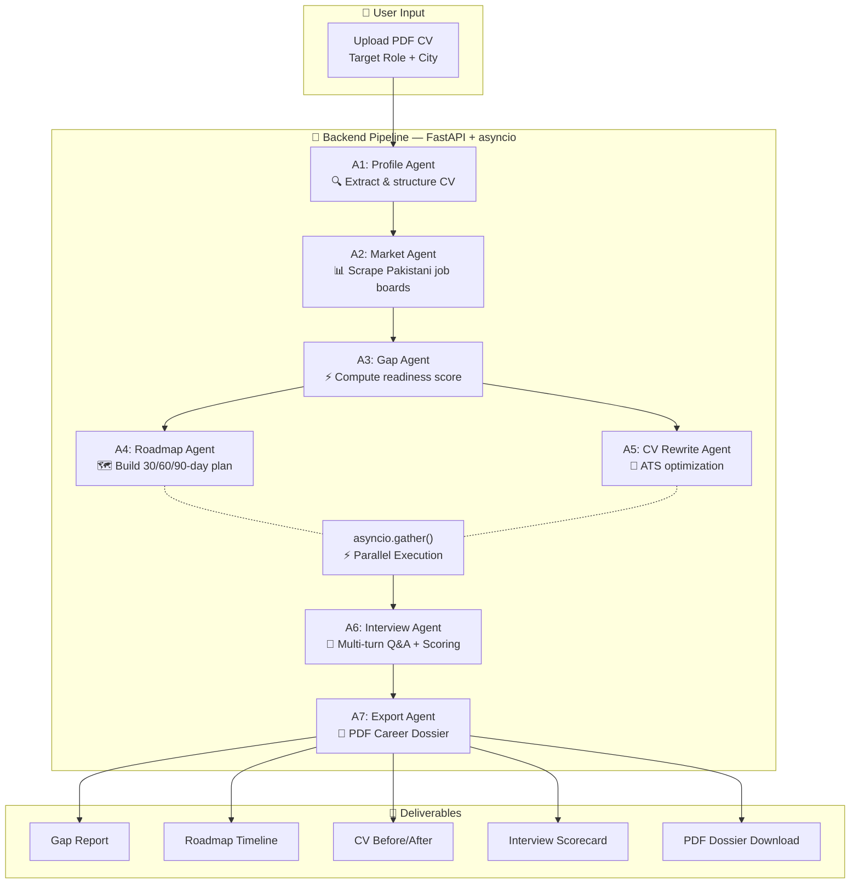

# Ustaad (اُستاد) — AI Career OS for Pakistani Tech Talent

<div align="center">

[](https://www.kaggle.com/competitions/vibecoding-agents-capstone-project)
[](https://aistudio.google.com/)
[](https://fastapi.tiangolo.com/)
[](https://nextjs.org/)
[](https://opensource.org/licenses/MIT)

<br/>

> **Ustaad** *(Urdu: اُستاد — Teacher / Master)* is an AI-powered **Career Operating System** purpose-built to help Pakistani technology graduates navigate, prepare for, and succeed in the local tech job market.

**"The career coach Pakistan never had."**

</div>

---

## 📋 Table of Contents

1. [The Problem & Mission](#-the-problem--mission)
2. [Live Demo](#-live-demo)
3. [Competition Track](#-competition-track)
4. [Multi-Agent Architecture](#️-multi-agent-architecture--pipeline)
5. [The 7 Agents — Detailed Breakdown](#-the-7-agents--detailed-breakdown)
6. [Course Concepts Demonstrated](#-course-concepts-demonstrated)
7. [Tech Stack](#️-tech-stack)
8. [Project Structure](#-project-structure)
9. [Setup & Installation](#-setup--installation)
10. [Environment Variables](#-environment-variables)
11. [API Reference](#-api-reference)
12. [The Team](#-the-team)
13. [License](#-license)

---

## 🎯 The Problem & Mission

Every year, **tens of thousands of CS and IT graduates** enter Pakistan's technology sector. A critical disconnect persists between university curricula and real industry demands. Graduates face:

| Challenge | Reality |
|---|---|
| **Curriculum Gaps** | No clear signal on which skills Pakistani employers in Karachi, Lahore, and Islamabad actually need |
| **ATS Incompatibility** | Resumes that fail automated Applicant Tracking System screening before any human ever reads them |
| **No Interview Prep** | Little to no access to structured, domain-specific mock interview practice |
| **Career Blindness** | No benchmarking mechanism to understand where they stand vs. market demand |

**Ustaad** solves this by serving as a fully-automated, AI-driven personal career concierge. A user uploads a single PDF CV, specifies their target role and city, and the system delivers:

- ✅ **Real-time market snapshot** grounded in live Pakistani job board data
- ✅ **Honest skill gap analysis** with a quantified readiness score
- ✅ **30/60/90-day personalized learning roadmap** with free resource links
- ✅ **ATS-optimized CV rewrite** with keyword improvements and before/after comparison
- ✅ **Multi-turn mock interview** with AI scoring and feedback on each answer
- ✅ **Downloadable PDF Career Dossier** summarizing all findings

---

## 🚀 Live Demo

> 🔗 **[Watch the 5-minute demo video on YouTube](#)** *(link to be added)*

The demo walks through a real CV submission, live pipeline execution with SSE streaming, and the full dossier output.

---

## 🏆 Competition Track

**Submitted to**: [AI Agents Intensive — Vibe Coding Capstone 2026](https://www.kaggle.com/competitions/vibecoding-agents-capstone-project)

**Track**: **Agents for Business / Agents for Good**

Ustaad addresses a dual mandate:
- **Business**: Helps companies find better-prepared candidates (reduced hiring friction)
- **Good**: Democratizes career coaching for graduates who cannot afford professional coaching services

---

## 🏗️ Multi-Agent Architecture & Pipeline

Ustaad's backend orchestrates a **7-Agent Pipeline** using sequential dependencies and concurrent execution pathways. The architecture maximizes efficiency through `asyncio.gather()` parallelism and streams real-time progress to the frontend via Server-Sent Events (SSE).



### Pipeline Flow Summary

```
Upload CV → [A1 Profile] → [A2 Market] → [A3 Gap]
                                              ↙          ↘
                                    [A4 Roadmap]  [A5 CV Rewrite]  ← parallel
                                              ↘          ↙
                                         [A6 Interview]
                                              ↓
                                         [A7 Export → PDF]
```

---

## 🤖 The 7 Agents — Detailed Breakdown

| # | Agent | Role | Input | Output | LLM |
|---|---|---|---|---|---|
| **A1** | **Profile Agent** | Parses raw CV text into a structured JSON resume profile (education, experience, skills, projects) | Raw CV text + target role | `ProfileSchema` JSON | Gemini 2.5 Flash |
| **A2** | **Market Intelligence Agent** | Runs 4 targeted Serper.dev queries against Rozee.pk, Mustakbil, and LinkedIn Pakistan for live job requirements | Target role + city | `MarketDataSchema` JSON | Gemini 2.5 Flash |
| **A3** | **Gap Analysis Agent** | Compares candidate profile vs. market demand, computes a quantified readiness score (0–100) and lists critical skill gaps | A1 Profile + A2 Market data | `GapAnalysisSchema` JSON | Gemini 2.5 Flash |
| **A4** | **Roadmap Agent** | Builds a milestone-driven 30/60/90-day learning plan with free resource links targeted at closing identified gaps | A3 Gap data | `RoadmapSchema` JSON | Gemini 2.5 Flash |
| **A5** | **CV Rewrite Agent** | Rewrites CV bullet points and summary for ATS optimization using local keyword mappings; estimates ATS score improvement | A1 Profile + A2 Market + A3 Gap | `CVRewriteSchema` JSON | Gemini 2.5 Flash |
| **A6** | **Interview Agent** | Runs a multi-turn interactive mock interview (15 questions), evaluates each answer on a 1–10 rubric | A1 Profile + A2 Market + user answers | Per-answer feedback + scores | Gemini 2.5 Flash |
| **A7** | **Export Agent** | Aggregates all pipeline outputs into a formatted, styled PDF Career Dossier using ReportLab | Full session data from Supabase | Downloadable PDF | ReportLab SDK |

---

## 🎓 Course Concepts Demonstrated

This project directly demonstrates **4 of the core agentic paradigms** from the Google AI Agents Intensive course:

### 1. ✅ Multi-Agent Collaboration & Orchestration
The `orchestrator.py` coordinates 7 specialized agents in a dependency graph. Agents 4 and 5 are dispatched **in parallel** using `asyncio.gather()`, reducing total pipeline time by ~40% compared to sequential execution. Each agent maintains a single responsibility and communicates exclusively through typed JSON schemas.

```python
# Parallel execution of Roadmap + CV Rewrite agents
roadmap_data, cv_rewrite_data = await asyncio.gather(
    run_roadmap_agent(gap_data),
    run_cv_rewrite_agent(profile_data, market_data, gap_data)
)
```

### 2. ✅ Tool Use & Real-Time Grounding
The **Market Intelligence Agent** calls **Serper.dev** to execute 4 live Google Search queries per session, specifically targeting Pakistani job portals:
```
"Python Developer jobs Karachi site:rozee.pk"
"Python Developer requirements Pakistan mustakbil"
```
This grounds every downstream analysis in **real market data**, not LLM training set approximations — a fundamental agentic capability.

### 3. ✅ Structured Outputs & Schema Hardening
Every agent enforces a strict output schema via Gemini's `response_mime_type="application/json"`. The `parse_gemini_json()` utility implements a **4-layer parsing fallback**:
1. Direct `json.loads()`
2. Markdown fence stripping + extraction
3. Trailing comma cleanup via regex
4. `ast.literal_eval()` for Python-like dict strings

This makes the pipeline resilient against malformed LLM responses across both Gemini and the Qwen fallback model.

### 4. ✅ Production-Focused Async Pipeline Design
- **Server-Sent Events (SSE)**: Pipeline status events are streamed in real-time to the Next.js frontend via an `asyncio.Queue` + SSE generator pattern, giving users live progress updates without polling.
- **Exponential Backoff**: Gemini calls retry up to 8 times with `min(2^attempt, 15)` second waits on rate-limit errors.
- **Model Failover**: If Gemini quota is exhausted, the pipeline automatically falls back to a secondary Qwen 3.5 9b model (I used it for rapid testing purposes... Completely ignore it as it is a part of testing) hosted on Kaggle via ngrok (configurable via `KAGGLE_LLM_URL`).

---

## 🛠️ Tech Stack

| Layer | Technology | Purpose |
|---|---|---|
| **Frontend** | Next.js 14, TypeScript | App Router, SSR/CSR hybrid pages |
| **Styling** | Tailwind CSS, Framer Motion | Responsive UI, scroll animations |
| **Icons** | Lucide React | Consistent professional icon set |
| **Backend** | Python 3.10+, FastAPI | Async REST API + SSE endpoint |
| **PDF Parsing** | PyMuPDF (fitz) | CV text extraction from PDF uploads |
| **AI/LLM** | Google Gemini 2.5 Flash | 7-agent pipeline backbone |
| **Fallback LLM** | Qwen 3.5 9b (Kaggle-hosted) | Model resilience / quota overflow |
| **Search API** | Serper.dev | Real-time job board grounding |
| **Database** | Supabase (PostgreSQL) | Session state, interview history |
| **PDF Generation** | ReportLab | Career Dossier PDF output |

---

## 📂 Project Structure

```
ustaad/
├── backend/
│   ├── agents/
│   │   ├── prompts/                # LLM system instruction templates
│   │   │   ├── profile_prompt.py   # CV parser schema & instructions
│   │   │   ├── market_prompt.py    # Job board search + analysis prompt
│   │   │   ├── gap_prompt.py       # Gap scoring rubric & schema
│   │   │   ├── roadmap_prompt.py   # 30/60/90 learning plan schema
│   │   │   ├── cv_rewrite_prompt.py# ATS optimization instructions
│   │   │   └── interview_prompt.py # Q&A generation + scoring rubric
│   │   ├── gemini_utils.py         # Shared LLM client, retry, JSON parsing
│   │   ├── orchestrator.py         # Pipeline manager (SSE, parallel flows)
│   │   ├── profile_agent.py        # A1: CV Parser Agent
│   │   ├── market_agent.py         # A2: Market Intelligence Agent
│   │   ├── gap_agent.py            # A3: Gap Analysis Agent
│   │   ├── roadmap_agent.py        # A4: Learning Roadmap Agent
│   │   ├── cv_rewrite_agent.py     # A5: ATS CV Rewrite Agent
│   │   └── interview_agent.py      # A6: Mock Interview Agent
│   ├── db/
│   │   ├── supabase_client.py      # Supabase async client helpers
│   │   └── schemas.sql             # SQL table definitions for Supabase
│   ├── routers/
│   │   ├── pipeline.py             # POST /api/pipeline/start + SSE stream
│   │   ├── interview.py            # POST /api/interview/answer
│   │   └── export.py               # GET /api/export/pdf/{session_id}
│   ├── tools/
│   │   ├── cv_parser.py            # PyMuPDF PDF text extraction
│   │   ├── job_scraper.py          # Serper.dev Google Search integration
│   │   └── pdf_generator.py        # ReportLab career dossier builder
│   ├── main.py                     # FastAPI app entry + CORS config
│   ├── requirements.txt
│   └── .env.example
├── frontend/
│   ├── app/
│   │   ├── page.tsx                # Landing page with CV upload form
│   │   ├── about/page.tsx          # About page (team, architecture)
│   │   ├── dashboard/[sessionId]/  # Live pipeline dashboard
│   │   ├── interview/[sessionId]/  # Mock interview terminal
│   │   └── dossier/[sessionId]/    # Full dossier results view
│   ├── components/
│   │   ├── PipelineProgress.tsx    # Real-time SSE-driven progress cards
│   │   ├── CVComparison.tsx        # Before/after CV diff view
│   │   ├── GapReport.tsx           # Skills gap visualization
│   │   ├── MarketSnapshot.tsx      # Job market demand cards
│   │   ├── RoadmapTimeline.tsx     # 30/60/90 roadmap timeline
│   │   ├── Skeleton.tsx            # Loading skeletons
│   │   └── ThemeToggle.tsx         # Dark/light mode toggle
│   ├── lib/
│   │   ├── api.ts                  # Typed API fetch wrappers
│   │   └── sse.ts                  # SSE EventSource listener
│   └── package.json
├── README.md
└── LICENSE
```

---

## 🚀 Setup & Installation

### Prerequisites

- Python 3.10+
- Node.js 18+
- A [Supabase](https://supabase.com/) project (free tier works)
- A [Google AI Studio](https://aistudio.google.com/) account (for Gemini API key)
- A [Serper.dev](https://serper.dev/) account (for job search API key)

---

### Step 1: Database Setup (Supabase)

1. Create a free project at [Supabase](https://supabase.com/)
2. Open **SQL Editor** and run the schema:

```sql
-- From backend/db/schemas.sql
CREATE TABLE sessions (
  id UUID PRIMARY KEY DEFAULT gen_random_uuid(),
  status TEXT NOT NULL DEFAULT 'pending',
  cv_text TEXT,
  target_role TEXT,
  target_city TEXT,
  experience_years NUMERIC,
  education_level TEXT,
  profile_data JSONB,
  market_data JSONB,
  gap_data JSONB,
  roadmap_data JSONB,
  cv_rewrite_data JSONB,
  error_message TEXT,
  completed_agents TEXT[] DEFAULT '{}',
  created_at TIMESTAMPTZ DEFAULT now()
);

CREATE TABLE interview_sessions (
  id UUID PRIMARY KEY DEFAULT gen_random_uuid(),
  session_id UUID REFERENCES sessions(id),
  question TEXT,
  user_answer TEXT,
  ai_feedback TEXT,
  score INTEGER,
  question_number INTEGER,
  created_at TIMESTAMPTZ DEFAULT now()
);
```

---

### Step 2: Backend Setup (FastAPI)

```bash
# Navigate to backend
cd backend

# Create virtual environment
python -m venv venv

# Activate (Windows)
venv\Scripts\activate
# Activate (macOS/Linux)
source venv/bin/activate

# Install dependencies
pip install -r requirements.txt

# Configure environment
cp .env.example .env
# → Edit .env with your API keys (see Environment Variables section below)

# Start the backend server
uvicorn main:app --reload --port 8000
```

Backend runs at `http://localhost:8000`. Health check: `GET /health`

---

### Step 3: Frontend Setup (Next.js)

```bash
# Navigate to frontend (from project root)
cd frontend

# Install Node dependencies
npm install

# Configure environment
cp .env.example .env.local
# → Set NEXT_PUBLIC_API_URL=http://localhost:8000

# Start the development server
npm run dev
```

Frontend runs at `http://localhost:3000`

---

## 🔐 Environment Variables

### Backend (`backend/.env`)

```env
# AI / LLM
GEMINI_API_KEY=your_gemini_api_key_here
GEMINI_MODEL=models/gemini-2.5-flash

# Search / Grounding
SERPER_API_KEY=your_serper_dev_api_key_here

# Database
SUPABASE_URL=https://your-project.supabase.co
SUPABASE_SERVICE_KEY=your_supabase_service_role_key

# Optional: Fallback LLM (Kaggle-hosted Qwen via ngrok)
# When set, system auto-failovers to this model if Gemini quota is exhausted
KAGGLE_LLM_URL=https://your-ngrok-url.ngrok-free.app/v1/chat/completions

# CORS
CORS_ORIGINS=http://localhost:3000,http://localhost:3001
```

### Frontend (`frontend/.env.local`)

```env
NEXT_PUBLIC_API_URL=http://localhost:8000
```

> ⚠️ **Never commit `.env` files.** Both are listed in `.gitignore`. Use `.env.example` files as templates.

---

## 📡 API Reference

| Method | Endpoint | Description |
|---|---|---|
| `GET` | `/health` | Backend health check |
| `POST` | `/api/pipeline/start` | Upload CV + start pipeline (returns `session_id`) |
| `GET` | `/api/pipeline/status/{session_id}` | SSE stream of real-time pipeline events |
| `GET` | `/api/pipeline/results/{session_id}` | Full JSON results for completed session |
| `POST` | `/api/interview/answer` | Submit interview answer, get AI scoring |
| `GET` | `/api/export/pdf/{session_id}` | Download Career Dossier PDF |

---

## 👥 The Team

<table>
  <tr>
    <td align="center">
      <br/>
      <b>Syed Muhammad Hassan</b><br/>
      <sub>Backend Architecture & AI Agent Pipeline</sub><br/>
      <a href="https://github.com/Muhammad-Hassan12">GitHub</a> •
      <a href="https://www.linkedin.com/in/syed-muhammad-hassan-aa112928b/">LinkedIn</a>
    </td>
    <td align="center">
      <br/>
      <b>Abdul Mannan Fazlani</b><br/>
      <sub>Frontend Engineering & UI/UX Design</sub><br/>
      <a href="https://github.com/abdulmannan991">GitHub</a> •
      <a href="https://www.linkedin.com/in/abdul-mannan-fazlani-47b274293/">LinkedIn</a>
    </td>
  </tr>
</table>

**Organization**: [AgenticEra Systems](https://github.com/AgenticEraSystems) — AI automation for the real world.

---

## 📄 License

This project is licensed under the **MIT License**.

```
MIT License

Copyright (c) 2026 AgenticEra Systems

Permission is hereby granted, free of charge, to any person obtaining a copy
of this software and associated documentation files (the "Software"), to deal
in the Software without restriction, including without limitation the rights
to use, copy, modify, merge, publish, distribute, sublicense, and/or sell
copies of the Software, and to permit persons to whom the Software is
furnished to do so, subject to the following conditions:

The above copyright notice and this permission notice shall be included in all
copies or substantial portions of the Software.
```

---

<div align="center">

Built with ❤️ in Karachi, Pakistan 🇵🇰 · Powered by Gemini 2.5 Flash 🤖

**[Try Ustaad](#)** · **[Watch Demo](#)** · **[Kaggle Competition](https://www.kaggle.com/competitions/vibecoding-agents-capstone-project)**

</div>
