# Ustaad Career OS — Remaining Work Implementation Plan

> **Goal:** Bring the project from 7.2/10 to 9.0+/10 and make it fully submission-ready for the Kaggle AI Agents Capstone competition (deadline: July 6, 2026).

---

## Phase Overview

| Phase | Focus | Est. Time | Impact |
|---|---|---|---|
| **Phase 7** | Backend Code Quality Refactoring | ~20 min | Eliminates all code duplication, fixes async issues |
| **Phase 8** | Gemini SDK Hardening | ~10 min | Adds `response_mime_type`, temperature tuning, robust parsing |
| **Phase 9** | Backend Robustness & Validation | ~15 min | Input validation, error handling, CV parser safety |
| **Phase 10** | Frontend UX Polish | ~25 min | Loading skeletons, error boundary, micro-animations |
| **Phase 11** | Documentation & Repo Readiness | ~15 min | Root README.md, .env.example, .gitignore, architecture docs |
| **Phase 12** | Kaggle Writeup Draft | ~10 min | Competition-ready writeup template you can submit directly |

---

## Phase 7: Backend Code Quality Refactoring

> **Problem:** `parse_gemini_json()` and `call_gemini_with_retry()` are copy-pasted identically across all 6 agent files. `genai.configure()` is called 6 times redundantly. Supabase functions pretend to be async but block the event loop.

---

### 7.1 — Create Shared Gemini Utilities Module

#### [NEW] `backend/agents/gemini_utils.py`

Consolidate all duplicated logic into a single shared module:

```python
"""
Shared utilities for Gemini-powered agents.
Centralises configuration, retry logic, and JSON parsing
so individual agents stay lean and focused on their prompts.
"""
import google.generativeai as genai
import asyncio
import json
import re
import os
from dotenv import load_dotenv

load_dotenv()
genai.configure(api_key=os.getenv("GEMINI_API_KEY"))


def get_model(system_instruction: str, model_name: str = "gemini-2.5-flash") -> genai.GenerativeModel:
    """Create a configured Gemini model instance with structured output settings."""
    return genai.GenerativeModel(
        model_name=model_name,
        system_instruction=system_instruction,
        generation_config=genai.GenerationConfig(
            response_mime_type="application/json",
            temperature=0.7,
        ),
    )


def parse_gemini_json(text: str) -> dict:
    """
    Parse JSON from Gemini response, handling markdown fences,
    leading/trailing text, and nested code blocks.
    """
    # Try direct parse first (fastest path when response_mime_type works)
    try:
        return json.loads(text.strip())
    except json.JSONDecodeError:
        pass

    # Strip markdown code block fences
    clean = re.sub(r"```(?:json)?\s*", "", text).strip()
    clean = clean.rstrip("`").strip()

    # Try to extract JSON object/array from surrounding text
    for start_char, end_char in [("{", "}"), ("[", "]")]:
        start_idx = clean.find(start_char)
        end_idx = clean.rfind(end_char)
        if start_idx != -1 and end_idx != -1 and end_idx > start_idx:
            try:
                return json.loads(clean[start_idx : end_idx + 1])
            except json.JSONDecodeError:
                continue

    # Last resort — original approach
    return json.loads(clean)


async def call_gemini(model: genai.GenerativeModel, prompt: str, max_retries: int = 5) -> str:
    """
    Call Gemini with exponential backoff retry on quota errors.
    Returns raw response text.
    """
    for attempt in range(max_retries):
        try:
            response = await model.generate_content_async(prompt)
            return response.text
        except Exception as e:
            if "429" in str(e) or "quota" in str(e).lower():
                wait = 2 ** attempt
                await asyncio.sleep(wait)
            else:
                raise e
    raise Exception("Gemini max retries exceeded")


async def call_gemini_json(model: genai.GenerativeModel, prompt: str, max_retries: int = 5) -> dict:
    """Convenience: call Gemini and parse JSON response in one step."""
    raw = await call_gemini(model, prompt, max_retries)
    return parse_gemini_json(raw)
```

**Key improvements over current code:**
- `response_mime_type="application/json"` — tells Gemini to return raw JSON (no fences)
- `temperature=0.7` — balanced creativity vs. determinism for structured outputs
- `parse_gemini_json()` is now much more robust with multi-fallback parsing
- `call_gemini_json()` combines the two most common operations into one call
- `genai.configure()` runs exactly once at import time

---

### 7.2 — Refactor All 6 Agent Files

Each agent file should be simplified to **just the prompt + one function call**. Here is the pattern for every agent:

#### [MODIFY] `backend/agents/profile_agent.py`

**Before** (~52 lines with duplicated code):
```python
import google.generativeai as genai
import asyncio, json, re, os
from dotenv import load_dotenv
# ... 15 lines of duplicated utility functions ...

async def run_profile_agent(...) -> dict:
    model = genai.GenerativeModel(...)
    prompt = PROFILE_USER_TEMPLATE.format(...)
    raw = await call_gemini_with_retry(model, prompt)
    return parse_gemini_json(raw)
```

**After** (~18 lines, clean):
```python
from agents.gemini_utils import get_model, call_gemini_json
from agents.prompts.profile_prompt import PROFILE_SYSTEM_PROMPT, PROFILE_USER_TEMPLATE


async def run_profile_agent(
    cv_text: str,
    target_role: str,
    target_city: str,
    experience_years: float,
    education_level: str,
) -> dict:
    model = get_model(PROFILE_SYSTEM_PROMPT)
    prompt = PROFILE_USER_TEMPLATE.format(
        cv_text=cv_text,
        target_role=target_role,
        target_city=target_city,
        experience_years=experience_years,
        education_level=education_level,
    )
    return await call_gemini_json(model, prompt)
```

**Apply the same pattern to all 6 agents:**
- [MODIFY] `backend/agents/market_agent.py` — same refactor + keep `search_pakistan_job_market` import
- [MODIFY] `backend/agents/gap_agent.py` — same refactor
- [MODIFY] `backend/agents/roadmap_agent.py` — same refactor
- [MODIFY] `backend/agents/cv_rewrite_agent.py` — same refactor
- [MODIFY] `backend/agents/interview_agent.py` — same refactor for both `generate_interview_questions` and `evaluate_answer`

---

### 7.3 — Fix Fake-Async Supabase Client

#### [MODIFY] `backend/db/supabase_client.py`

Wrap all synchronous Supabase SDK calls with `asyncio.to_thread()` so they don't block the FastAPI event loop:

```python
import asyncio
from supabase import create_client, Client
from dotenv import load_dotenv
import os

load_dotenv()

supabase_url = os.getenv("SUPABASE_URL", "")
if supabase_url.endswith("/rest/v1/"):
    supabase_url = supabase_url[:-9]
elif supabase_url.endswith("/rest/v1"):
    supabase_url = supabase_url[:-8]

supabase: Client = create_client(
    supabase_url,
    os.getenv("SUPABASE_SERVICE_KEY")
)


def _create_session_sync(target_role: str, target_city: str, cv_text: str) -> str:
    result = supabase.table("sessions").insert({
        "target_role": target_role,
        "target_city": target_city,
        "cv_text": cv_text,
        "status": "running"
    }).execute()
    return result.data[0]["id"]


async def create_session(target_role: str, target_city: str, cv_text: str) -> str:
    return await asyncio.to_thread(_create_session_sync, target_role, target_city, cv_text)


def _update_session_sync(session_id: str, updates: dict):
    supabase.table("sessions").update(updates).eq("id", session_id).execute()


async def update_session(session_id: str, updates: dict):
    await asyncio.to_thread(_update_session_sync, session_id, updates)


def _get_session_sync(session_id: str) -> dict:
    result = supabase.table("sessions").select("*").eq("id", session_id).execute()
    if result.data:
        return result.data[0]
    return {}


async def get_session(session_id: str) -> dict:
    return await asyncio.to_thread(_get_session_sync, session_id)


def _mark_agent_complete_sync(session_id: str, agent_name: str, data: dict):
    session = _get_session_sync(session_id)
    completed = session.get("agents_completed", []) or []
    if agent_name not in completed:
        completed.append(agent_name)
    supabase.table("sessions").update({
        f"{agent_name}_data": data,
        "agents_completed": completed,
        "current_agent": agent_name
    }).eq("id", session_id).execute()


async def mark_agent_complete(session_id: str, agent_name: str, data: dict):
    await asyncio.to_thread(_mark_agent_complete_sync, session_id, agent_name, data)
```

**Why this matters:** Previously, every Supabase call blocked the entire async event loop. With `asyncio.to_thread()`, these calls run in a thread pool, keeping FastAPI responsive during DB operations.

---

### Phase 7 Verification
- Run `uvicorn main:app --reload --port 8001` — server should start without import errors.
- Upload a CV through the frontend — the full pipeline (A1→A5) should complete successfully.
- Confirm SSE events still stream correctly to the dashboard.

---

## Phase 8: Gemini SDK Hardening

> **Problem:** JSON parsing relies solely on prompt instructions. No temperature control. Edge cases in Gemini output can crash parsing.

---

### 8.1 — Already handled in Phase 7

The `get_model()` function in `gemini_utils.py` already adds:
- `response_mime_type="application/json"` — tells Gemini to output raw JSON
- `temperature=0.7` — balanced for structured outputs

### 8.2 — Add Fallback Model Configuration

#### [MODIFY] `backend/agents/gemini_utils.py`

Add an environment variable to control the model name:

```python
DEFAULT_MODEL = os.getenv("GEMINI_MODEL", "gemini-2.5-flash")

def get_model(system_instruction: str, model_name: str = None) -> genai.GenerativeModel:
    return genai.GenerativeModel(
        model_name=model_name or DEFAULT_MODEL,
        system_instruction=system_instruction,
        generation_config=genai.GenerationConfig(
            response_mime_type="application/json",
            temperature=0.7,
        ),
    )
```

This lets you switch models via `.env` (`GEMINI_MODEL=gemini-2.5-pro`) without touching any agent code.

### 8.3 — Add Logging for Agent Calls

Add a simple logger to `gemini_utils.py` so you can trace pipeline execution:

```python
import logging
logger = logging.getLogger("ustaad.agents")

async def call_gemini_json(model, prompt, max_retries=5) -> dict:
    logger.info(f"Calling Gemini ({model.model_name})...")
    raw = await call_gemini(model, prompt, max_retries)
    result = parse_gemini_json(raw)
    logger.info(f"Gemini response parsed successfully ({len(raw)} chars)")
    return result
```

---

### Phase 8 Verification
- Set `GEMINI_MODEL=gemini-2.5-flash` in `.env` and confirm it's used.
- Check terminal logs show "Calling Gemini..." and "parsed successfully" messages.
- Intentionally remove `response_mime_type` temporarily to confirm the fallback parser still handles markdown-fenced JSON.

---

## Phase 9: Backend Robustness & Validation

> **Problem:** No input validation on uploads or interview answers. CV parser crashes on non-PDF. No max-length guards before Gemini calls.

---

### 9.1 — Harden CV Parser

#### [MODIFY] `backend/tools/cv_parser.py`

```python
import fitz  # PyMuPDF


class CVParseError(Exception):
    """Raised when CV extraction fails."""
    pass


def extract_cv_text(pdf_bytes: bytes) -> str:
    """Extract all text from a PDF CV given its raw bytes."""
    if not pdf_bytes or len(pdf_bytes) < 10:
        raise CVParseError("The uploaded file is empty or too small to be a valid PDF.")
    
    try:
        doc = fitz.open(stream=pdf_bytes, filetype="pdf")
    except Exception:
        raise CVParseError("The uploaded file is not a valid PDF. Please upload a .pdf file.")
    
    full_text = ""
    for page in doc:
        full_text += page.get_text()
    doc.close()
    
    text = full_text.strip()
    if len(text) < 50:
        raise CVParseError("Could not extract enough text from the PDF. Is it a scanned image? Please use a text-based PDF.")
    
    return text
```

### 9.2 — Add Input Validation to Pipeline Router

#### [MODIFY] `backend/routers/pipeline.py`

Add validation for file type, size, and form fields:

```python
from fastapi import APIRouter, UploadFile, File, Form, BackgroundTasks, HTTPException
from fastapi.responses import StreamingResponse
from tools.cv_parser import extract_cv_text, CVParseError
from agents.orchestrator import run_pipeline
from db.supabase_client import create_session, get_session
import asyncio
import json

router = APIRouter(prefix="/api/pipeline")

status_queues: dict[str, asyncio.Queue] = {}

MAX_FILE_SIZE = 5 * 1024 * 1024  # 5 MB
ALLOWED_TYPES = ["application/pdf"]


@router.post("/start")
async def start_pipeline(
    background_tasks: BackgroundTasks,
    cv_file: UploadFile = File(...),
    target_role: str = Form(...),
    target_city: str = Form(...),
    experience_years: float = Form(0.0),
    education_level: str = Form("Bachelor's"),
):
    # Validate file type
    if cv_file.content_type not in ALLOWED_TYPES:
        raise HTTPException(status_code=400, detail="Only PDF files are accepted. Please upload a .pdf CV.")

    cv_bytes = await cv_file.read()

    # Validate file size
    if len(cv_bytes) > MAX_FILE_SIZE:
        raise HTTPException(status_code=400, detail="File is too large. Maximum size is 5 MB.")

    # Validate target role
    if not target_role.strip() or len(target_role) > 200:
        raise HTTPException(status_code=400, detail="Target role must be between 1 and 200 characters.")

    # Parse CV text with error handling
    try:
        cv_text = extract_cv_text(cv_bytes)
    except CVParseError as e:
        raise HTTPException(status_code=422, detail=str(e))

    session_id = await create_session(target_role.strip(), target_city.strip(), cv_text)

    queue = asyncio.Queue()
    status_queues[session_id] = queue

    background_tasks.add_task(
        run_pipeline,
        session_id, cv_text, target_role.strip(), target_city.strip(),
        experience_years, education_level, queue,
    )

    return {"session_id": session_id}

# ... rest of the file stays the same (status + results endpoints)
```

### 9.3 — Add Input Validation to Interview Router

#### [MODIFY] `backend/routers/interview.py`

Add max-length guard on answer submissions:

```python
# Add this constant at the top of the file
MAX_ANSWER_LENGTH = 5000  # characters

# In the submit_answer function, add this check right after parsing the payload:
@router.post("/answer")
async def submit_answer(payload: AnswerPayload):
    if len(payload.answer) > MAX_ANSWER_LENGTH:
        return {"error": f"Answer is too long. Maximum {MAX_ANSWER_LENGTH} characters."}
    
    # ... rest stays the same
```

---

### Phase 9 Verification
- Try uploading a `.txt` file → should get "Only PDF files are accepted" error.
- Try uploading a 10MB PDF → should get "File is too large" error.
- Try submitting an interview answer with 10,000+ characters → should get truncation error.
- Normal flow should still work unchanged.

---

## Phase 10: Frontend UX Polish

> **Problem:** No loading skeletons, no error boundaries, no micro-animations on card entry. Missing meta tags on sub-pages.

---

### 10.1 — Create a Skeleton/Shimmer Component

#### [NEW] `frontend/components/Skeleton.tsx`

A reusable shimmer component for loading states:

```tsx
"use client";

export default function Skeleton({ className = "" }: { className?: string }) {
  return (
    <div
      className={`animate-pulse bg-slate-200 dark:bg-slate-800 rounded-xl ${className}`}
    />
  );
}

export function CardSkeleton() {
  return (
    <div className="bg-white dark:bg-slate-900 border border-slate-200 dark:border-slate-800 rounded-2xl p-6 shadow-sm flex flex-col gap-4">
      <div className="flex justify-between items-center">
        <Skeleton className="h-6 w-48" />
        <Skeleton className="h-6 w-20 rounded-full" />
      </div>
      <Skeleton className="h-4 w-full" />
      <Skeleton className="h-4 w-3/4" />
      <div className="grid grid-cols-2 gap-4 mt-2">
        <Skeleton className="h-20 w-full" />
        <Skeleton className="h-20 w-full" />
      </div>
      <div className="flex gap-2 mt-2">
        <Skeleton className="h-7 w-16 rounded-lg" />
        <Skeleton className="h-7 w-20 rounded-lg" />
        <Skeleton className="h-7 w-14 rounded-lg" />
        <Skeleton className="h-7 w-18 rounded-lg" />
      </div>
    </div>
  );
}
```

### 10.2 — Create an Error Boundary Component

#### [NEW] `frontend/components/ErrorBoundary.tsx`

Catches unhandled React errors and shows a recovery UI:

```tsx
"use client";

import { Component, ReactNode } from "react";
import { AlertTriangle, RotateCcw } from "lucide-react";

interface Props {
  children: ReactNode;
  fallbackMessage?: string;
}

interface State {
  hasError: boolean;
  error: Error | null;
}

export default class ErrorBoundary extends Component<Props, State> {
  constructor(props: Props) {
    super(props);
    this.state = { hasError: false, error: null };
  }

  static getDerivedStateFromError(error: Error): State {
    return { hasError: true, error };
  }

  handleRetry = () => {
    this.setState({ hasError: false, error: null });
  };

  render() {
    if (this.state.hasError) {
      return (
        <div className="flex flex-col items-center justify-center py-16 px-6 text-center gap-4">
          <AlertTriangle className="w-12 h-12 text-amber-500" />
          <h3 className="text-lg font-semibold text-slate-800 dark:text-slate-200">
            Something went wrong
          </h3>
          <p className="text-xs text-slate-500 max-w-sm">
            {this.props.fallbackMessage || "An unexpected error occurred while rendering this section."}
          </p>
          <button
            onClick={this.handleRetry}
            className="mt-2 px-4 py-2 rounded-xl bg-indigo-600 hover:bg-indigo-700 text-white text-xs font-semibold flex items-center gap-1.5 cursor-pointer transition-colors"
          >
            <RotateCcw size={12} /> Try Again
          </button>
        </div>
      );
    }

    return this.props.children;
  }
}
```

### 10.3 — Add Framer Motion Card Entry Animations

#### [MODIFY] `frontend/app/dashboard/[sessionId]/page.tsx`

Wrap each result card with Framer Motion's `motion.div` for staggered fade-in-slide-up animations when agents complete:

```tsx
// Add to imports:
import { motion } from "framer-motion";

// Wrap each card like this:
{completedAgents.includes("market") && sessionData?.market_data && (
  <motion.div
    initial={{ opacity: 0, y: 20 }}
    animate={{ opacity: 1, y: 0 }}
    transition={{ duration: 0.4, ease: "easeOut" }}
  >
    <MarketSnapshot data={sessionData.market_data} />
  </motion.div>
)}
```

Apply the same pattern to all 4 result cards (MarketSnapshot, GapReport, RoadmapTimeline, CVComparison), incrementing the transition delay by 0.1s each for a staggered effect.

### 10.4 — Use Skeleton in Dashboard Waiting State

#### [MODIFY] `frontend/app/dashboard/[sessionId]/page.tsx`

Replace the simple spinner with shimmer skeletons:

```tsx
// Replace the current empty-state Loader2 spinner with:
import { CardSkeleton } from "@/components/Skeleton";

{completedAgents.length === 0 && status !== "error" && (
  <div className="flex flex-col gap-6">
    <CardSkeleton />
    <CardSkeleton />
  </div>
)}
```

### 10.5 — Wrap Pages with Error Boundary

#### [MODIFY] `frontend/app/layout.tsx`

Wrap the `{children}` in the layout with the `ErrorBoundary`:

```tsx
import ErrorBoundary from "@/components/ErrorBoundary";

// In the return, change:
<div className="flex-1 flex flex-col">
  <ErrorBoundary fallbackMessage="An error occurred in the application. Please refresh the page.">
    {children}
  </ErrorBoundary>
</div>
```

### 10.6 — Add Dynamic Page Titles

#### [NEW] `frontend/app/dashboard/[sessionId]/layout.tsx`

```tsx
import type { Metadata } from "next";

export const metadata: Metadata = {
  title: "Dashboard — Ustaad Career OS",
  description: "Real-time pipeline progress and career analysis results.",
};

export default function DashboardLayout({ children }: { children: React.ReactNode }) {
  return <>{children}</>;
}
```

#### [NEW] `frontend/app/interview/[sessionId]/layout.tsx`

```tsx
import type { Metadata } from "next";

export const metadata: Metadata = {
  title: "Mock Interview — Ustaad Career OS",
  description: "AI-powered mock interview with real-time scoring and feedback.",
};

export default function InterviewLayout({ children }: { children: React.ReactNode }) {
  return <>{children}</>;
}
```

#### [NEW] `frontend/app/dossier/[sessionId]/layout.tsx`

```tsx
import type { Metadata } from "next";

export const metadata: Metadata = {
  title: "Career Dossier — Ustaad Career OS",
  description: "Your complete career analysis report with market insights and recommendations.",
};

export default function DossierLayout({ children }: { children: React.ReactNode }) {
  return <>{children}</>;
}
```

---

### Phase 10 Verification
- Load the dashboard page → should see shimmer skeletons instead of just a spinner.
- Wait for agents to complete → cards should animate in with a smooth slide-up fade.
- Check browser tab titles on each page — should say "Dashboard —", "Mock Interview —", etc.
- Intentionally trigger a React error (e.g., pass invalid data to a component) → Error boundary should catch it with retry button.

---

## Phase 11: Documentation & Repo Readiness

> **Problem:** No root README, no .env.example, no architecture documentation. Judges need to understand the project in under 2 minutes.

---

### 11.1 — Create Root README.md

#### [NEW] `README.md` (at project root: `h:/Kaggle Competition/README.md`)

```markdown
# Ustaad (اُستاد) — AI Career OS for Pakistani Tech Talent

> **Kaggle × Google: 5-Day AI Agents Intensive Vibe Coding Capstone Project**

Ustaad is an AI-powered Career Operating System built specifically for Pakistani CS/IT graduates entering the tech job market. Upload your CV and Ustaad runs a 7-agent AI pipeline that analyzes your skills against real-time market data, identifies gaps, builds a personalized learning roadmap, rewrites your CV for ATS optimization, and conducts a scored mock interview — all in one session.

## ✨ Key Features

- **7-Agent AI Pipeline** — Profile parsing, market intelligence, gap analysis, roadmap generation, CV rewriting, mock interviews, and PDF export
- **Real-Time Market Data** — Grounded in live Pakistani job market data via Serper.dev (not hallucinated)
- **Parallel Agent Execution** — Roadmap + CV Rewrite agents run concurrently via `asyncio.gather()`
- **Live SSE Streaming** — Watch agents complete in real-time on the dashboard
- **15-Question Mock Interview** — Technical, behavioral, and HR questions with AI-scored feedback
- **Downloadable Career Dossier** — Professional PDF export with all analysis results
- **Premium Dark/Light UI** — Glassmorphic design with flash-free theme switching

## 🏗️ Architecture

[Architecture diagram here — see ustaad_implementation_plan.md]

**Agent Pipeline:**
```
A1 (Profile) → A2 (Market) → A3 (Gap) → [A4 (Roadmap) ‖ A5 (CV)] → A6 (Interview) → PDF Export
```

**Tech Stack:**
| Layer | Technology |
|---|---|
| Frontend | Next.js 14, TypeScript, Tailwind CSS, Framer Motion |
| Backend | Python, FastAPI, Uvicorn |
| AI | Google Gemini 2.5 Flash (via google-generativeai SDK) |
| Database | Supabase (PostgreSQL) |
| Search | Serper.dev (Google Search API) |
| PDF | ReportLab |

## 🚀 Quick Start

### Prerequisites
- Python 3.10+
- Node.js 18+
- Supabase project (free tier)
- API keys: Gemini, Serper.dev

### Backend Setup
```bash
cd backend
pip install -r requirements.txt
cp .env.example .env
# Edit .env with your actual API keys
uvicorn main:app --reload --port 8000
```

### Frontend Setup
```bash
cd frontend
npm install
cp .env.example .env.local
# Edit .env.local with your backend URL
npm run dev
```

### Database Setup
Run the SQL in `backend/db/schemas.sql` in your Supabase SQL Editor.

## 📂 Project Structure

```
├── backend/
│   ├── agents/           # 7 AI agents + orchestrator
│   │   ├── prompts/      # Structured prompt templates
│   │   ├── gemini_utils.py   # Shared Gemini SDK utilities
│   │   └── orchestrator.py   # Pipeline coordinator
│   ├── routers/          # FastAPI route handlers
│   ├── tools/            # CV parser, job scraper, PDF generator
│   └── db/               # Supabase client + SQL schemas
├── frontend/
│   ├── app/              # Next.js pages (landing, dashboard, interview, dossier)
│   ├── components/       # Reusable React components
│   └── lib/              # API client + SSE subscriber
└── README.md
```

## 🎯 Course Concepts Demonstrated

1. **Multi-Agent Systems** — 7 specialized agents with orchestrated data flow
2. **Agent Skills & Specialization** — Each agent has a distinct role and prompt
3. **Tool Use** — Serper.dev integration for real-time external data
4. **Structured Outputs** — Every agent enforces strict JSON schemas
5. **Production Workflows** — SSE streaming, async execution, persistent state

## 👥 Team

- **Hassan** — Backend / AI Agents
- **Abdul Mannan** — Frontend / UI

## 📄 License

MIT
```

---

### 11.2 — Create Backend .env.example

#### [NEW] `backend/.env.example`

```env
# Gemini API Key (get from https://aistudio.google.com/apikey)
GEMINI_API_KEY=your_gemini_api_key_here

# Serper.dev API Key (get from https://serper.dev)
SERPER_API_KEY=your_serper_api_key_here

# Supabase (get from your Supabase project settings)
SUPABASE_URL=https://your-project.supabase.co
SUPABASE_SERVICE_KEY=your_supabase_service_key_here

# CORS (comma-separated list of allowed origins)
CORS_ORIGINS=http://localhost:3000

# Optional: override default Gemini model
# GEMINI_MODEL=gemini-2.5-flash
```

### 11.3 — Create Frontend .env.example

#### [NEW] `frontend/.env.example`

```env
NEXT_PUBLIC_API_URL=http://localhost:8000
NEXT_PUBLIC_SUPABASE_URL=https://your-project.supabase.co
NEXT_PUBLIC_SUPABASE_ANON_KEY=your_supabase_anon_key_here
```

### 11.4 — Create Root .gitignore

#### [NEW] `.gitignore` (at project root: `h:/Kaggle Competition/.gitignore`)

```gitignore
# Environment files
.env
.env.local
.env.*.local

# Python
__pycache__/
*.pyc
*.pyo
*.egg-info/
venv/
.venv/

# Node
node_modules/
.next/
out/

# IDE
.vscode/
.idea/
*.swp
*.swo

# OS
.DS_Store
Thumbs.db

# Test artifacts
*.pdf
backend/answer_payload.json

# Gemini Antigravity
.agents/
```

### 11.5 — Clean Up Test Artifacts

#### [DELETE] the following files (they're test artifacts that shouldn't be in the repo):

- `backend/test_cv.pdf` — generated test file
- `backend/test_dossier.pdf` — generated test file
- `backend/answer_payload.json` — test data
- `backend/uvicorn` — appears to be an accidental file (0 bytes)

---

### Phase 11 Verification
- Read the README.md top-to-bottom — it should fully explain the project to a stranger.
- Verify `.env.example` files have placeholder values (not real keys).
- Verify `.gitignore` would exclude `.env`, `node_modules`, `__pycache__`, etc.
- Run `git status` from the project root — test files should not appear.

---

## Phase 12: Kaggle Writeup Draft

> **Problem:** The competition requires a Kaggle writeup with your submission. This is essentially your "elevator pitch" to the judges.

---

### 12.1 — Create Writeup Template

#### [NEW] `KAGGLE_WRITEUP.md` (at project root)

This file serves as your draft. Copy its contents into the Kaggle submission form:

```markdown
# Ustaad (اُستاد) — AI Career OS for Pakistani Tech Talent

## 🎯 The Problem

Every year, tens of thousands of CS/IT graduates enter Pakistan's tech job market — but most
lack the tools to understand what the market actually demands. They submit generic CVs, don't
know their skill gaps, and have no structured way to prepare for interviews. Ustaad bridges
this gap.

## 💡 The Solution

Ustaad is a full-stack AI Career Operating System. A user uploads their CV and specifies
their target role and city. Behind the scenes, 7 specialized AI agents work together:

1. **Profile Agent** — Extracts structured data from the CV
2. **Market Agent** — Searches the live Pakistani job market using Serper.dev
3. **Gap Agent** — Identifies critical, moderate, and minor skill gaps
4. **Roadmap Agent** — Builds a 30/60/90-day learning plan using only free resources
5. **CV Rewrite Agent** — Rewrites the CV for ATS optimization with market keywords
6. **Interview Agent** — Conducts a 15-question mock interview with AI scoring
7. **Export Agent** — Generates a downloadable Career Dossier PDF

Agents 4 and 5 run in **parallel** using `asyncio.gather()`, while a central orchestrator
streams real-time progress to the frontend via **Server-Sent Events (SSE)**.

## 🛠️ Course Concepts Demonstrated

| Concept | Implementation |
|---|---|
| **Multi-Agent Systems** | 7 agents with sequential + parallel orchestration |
| **Agent Specialization** | Each agent has a distinct prompt, schema, and responsibility |
| **Tool Use** | Serper.dev for real-time job market data (4 targeted queries per session) |
| **Structured Outputs** | Every agent enforces strict JSON schemas via `response_mime_type` |
| **Production Workflows** | SSE streaming, Supabase persistence, PDF generation, async pipeline |

## 🧪 Technical Highlights

- **Grounded market intelligence**: Market Agent uses live search results, not hallucinated data
- **Parallel execution**: Roadmap + CV Rewrite run concurrently, reducing total pipeline time
- **Real-time UI**: Dashboard cards appear progressively as agents complete
- **Flash-free dark mode**: Theme is applied via `<head>` injection before React hydrates
- **15-question interview**: Questions are personalized to the candidate's actual CV and projects

## 📂 Repository

[Link to your GitHub repo]

## 🎥 Video Demo

[Link to your video demonstration]

## 👥 Team

- **Hassan** — Backend, AI Agents, Pipeline Architecture
- **Abdul Mannan** — Frontend, UI/UX, Dashboard Design

## 🏷️ Track

**Concierge Agents** — A safe, useful personal career assistant for Pakistani tech graduates
```

---

### Phase 12 Verification
- Read the writeup as if you were a judge seeing it for the first time — does it make sense in 2 minutes?
- Ensure all claims match what the code actually does.
- Leave `[Link to...]` placeholders — you'll fill these in when you publish.

---

## Summary: Complete Execution Order

```mermaid
gantt
    title Remaining Work — Execution Timeline
    dateFormat HH:mm
    axisFormat %H:%M

    section Phase 7
    Create gemini_utils.py            :p7a, 00:00, 8m
    Refactor 6 agent files            :p7b, after p7a, 8m
    Fix async supabase_client.py      :p7c, after p7b, 5m

    section Phase 8
    Add env model config + logging    :p8a, after p7c, 5m

    section Phase 9
    Harden cv_parser.py               :p9a, after p8a, 5m
    Add pipeline validation           :p9b, after p9a, 5m
    Add interview validation          :p9c, after p9b, 3m

    section Phase 10
    Create Skeleton + ErrorBoundary   :p10a, after p9c, 8m
    Add Framer Motion animations      :p10b, after p10a, 5m
    Add skeletons to dashboard        :p10c, after p10b, 3m
    Add page layouts with meta        :p10d, after p10c, 5m

    section Phase 11
    Create README.md                  :p11a, after p10d, 5m
    Create .env.example files         :p11b, after p11a, 3m
    Create .gitignore                 :p11c, after p11b, 2m
    Clean test artifacts              :p11d, after p11c, 2m

    section Phase 12
    Create Kaggle writeup draft       :p12a, after p11d, 8m
```



> [!IMPORTANT]
> **After all phases are complete, you still need to:**
> 1. Push code to a **public GitHub repository**
> 2. Record a **3-5 minute video demonstration**
> 3. Submit on the **Kaggle competition page** with writeup + links
> 4. Deadline: **July 6, 2026, 11:59 PM PT**
